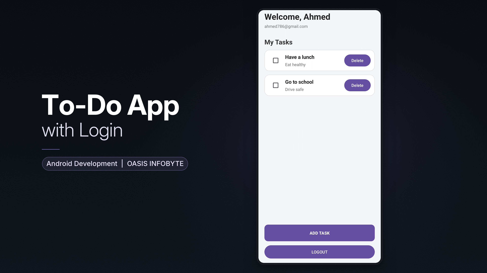

# Task 2: To-Do App with Login

An Android task-management application built with Java and XML. The app provides user authentication, task management, and local persistence using SQLite.

## Features

- User registration and login
- Password hashing before storage
- Create, view, update, and delete tasks
- Local task and user data stored with SQLite
- RecyclerView-based task list
- Session handling after login

## Technologies

- Java
- XML layouts
- Android SDK
- SQLite
- RecyclerView
- Gradle

## Architecture

The project separates the user interface, data models, database operations, and application logic into dedicated components. Repository abstractions help keep database access separate from the UI, making the code easier to maintain and extend.

## Run the App

1. Open the AppDev-T2-TodoAppWithLogin folder in Android Studio.
2. Allow Gradle synchronization to complete.
3. Start an Android emulator or connect a device.
4. Run the app from Android Studio.

This project was created as Task 2 of the OASIS INFOBYTE Android Development internship project set.
## 📸 Application Preview

*To-Do App with Login developed using Java and XML as part of the OASIS INFOBYTE Android Development Internship, Task 2.*
